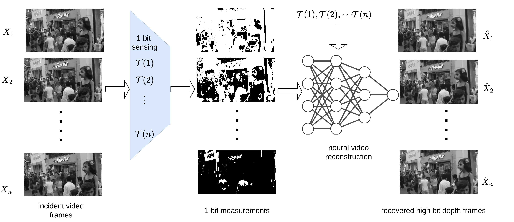

{{ page.authors }}

## Abstract

> We introduce a fundamentally new paradigm in video sensing, 1-bit computational video, that redefines the limits of imaging efficiency and performance. Instead of the conventional high-bit-depth capture, we show that one bit measurements captured by time-varying thresholding can be used to reconstruct full-bit-depth videos, eliminating the need for power-hungry, high-precision analog-to-digital conversion (ADC) at the sensor as well as reducing the energy consumption in data transmission. We propose thresholding strategies to effectively capture spatiotemporal dependencies in video streams. Despite the significant data compression at acquisition, we recover full-bit-depth videos with high fidelity through neural video reconstruction. Our method unlocks significant gains in memory efficiency, power savings, and data throughput reduction at the sensor, making it ideal for imaging systems with ultra-low-power requirements or high-speed video capture. We validate our framework on video recovery from simulated 1-bit measurements. Our work redefines the camera pipeline, potentially paving the way for gigapixel, kilohertz imaging systems on low-power sensor hardware.
> ## Resources

<a href=" {{ page.paperurl }} ">[pdf]</a> <a href=" {{ page.arxiv }} ">[arxiv]</a> <a href=" {{ page.code }} ">[github]</a> <a href=" {{ page.video }} ">[video]</a> <a href=" {{ page.poster }} ">[video]</a>

## Bibtex

@InProceedings{Gandikota_2026_CVPR,
    author    = {Gandikota, Kanchana Vaishnavi and Moeller, Michael and Kolb, Andreas and Choubey, Bhaskar and Chandramouli, Paramanand},
    title     = {A Bit is All You Need! Efficient Video Capture via Single Bit Imaging},
    booktitle = {Proceedings of the IEEE/CVF Conference on Computer Vision and Pattern Recognition (CVPR)},
    month     = {June},
    year      = {2026},
    pages     = {34016-34027}
}
