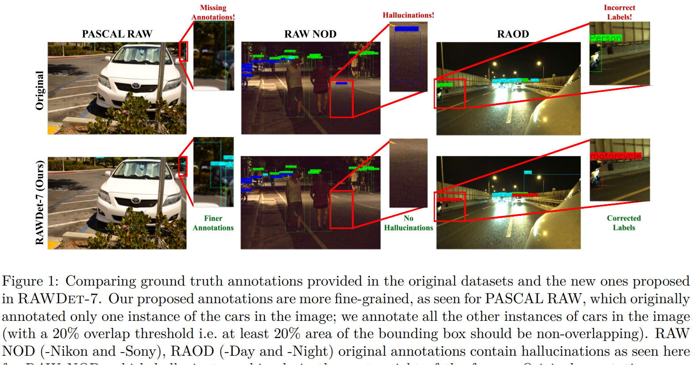

{{ page.authors }}

## Abstract

> Most vision models operate on 8-bit standard RGB (sRGB) images produced by dedicated image sensor processing pipelines designed for human perception rather than machine reasoning. In contrast, RAW images preserve sensor measurements, dynamic range, and fine-grained scene structure that can be critical for downstream understanding. Yet, progress in the RAW-domain vision remains limited by the lack of large-scale, high-quality benchmarks. To close this gap, we introduce RawDet-7, a multi-scenario benchmark for object detection and object description on quantized RAW images, comprising ~25k training and 7.6k test images consolidated from four datasets across diverse cameras, sensors, bit-depth precision, lighting conditions, and environments. RawDet-7 provides dense, standardized annotations for seven object categories, correcting missing labels, hallucinations, and inconsistencies in prior datasets, especially for small and partially-occluded instances. Beyond detection, we introduce an object-description track with detailed object-level descriptions derived from high-resolution sRGB references, enabling the study of how well different RAW processing pipelines remain aligned with high-resolution sRGB reference descriptions for fine-grained semantic, spatial, and contextual information. Finally, RawDet-7 supports controlled benchmarking under simulated 4-bit, 6-bit, and 8-bit quantization. Across standard detectors and a large grounding model, we show that suitable RAW-aware input mappings make low-bit RAW on par with, and in some settings superior to, sRGB pipelines, and, in the object-description track, achieve substantially higher agreement with high-resolution sRGB references than naive quantization.
> > ## Resources

<a href=" {{ page.paperurl }} ">[pdf]</a> <a href=" {{ page.arxiv }} ">[arxiv]</a> <a href=" {{ page.code }} ">[github]</a> <a href=" {{ page.video }} ">[video]</a> <a href=" {{ page.poster }} ">[video]</a>

## Bibtex

@article{
fatima2026rawdet,
title={{RAWD}et-7: A Multi-Scenario Benchmark for Object Detection and Description on Quantized {RAW} Images},
author={Mishal Fatima and Shashank Agnihotri and Kanchana Vaishnavi Gandikota and Michael Moeller and Margret Keuper},
journal={Transactions on Machine Learning Research},
issn={2835-8856},
year={2026},
url={https://openreview.net/forum?id=UHTJrsYieo},
note={}
}
